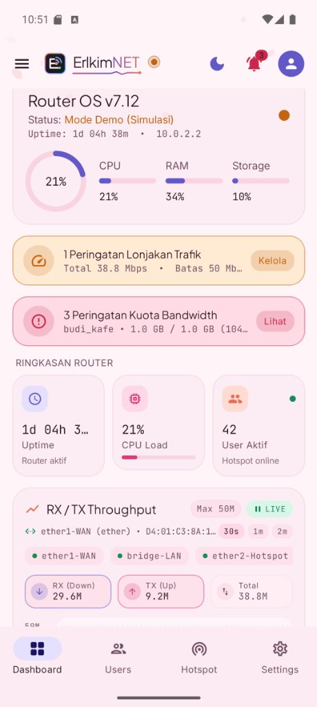
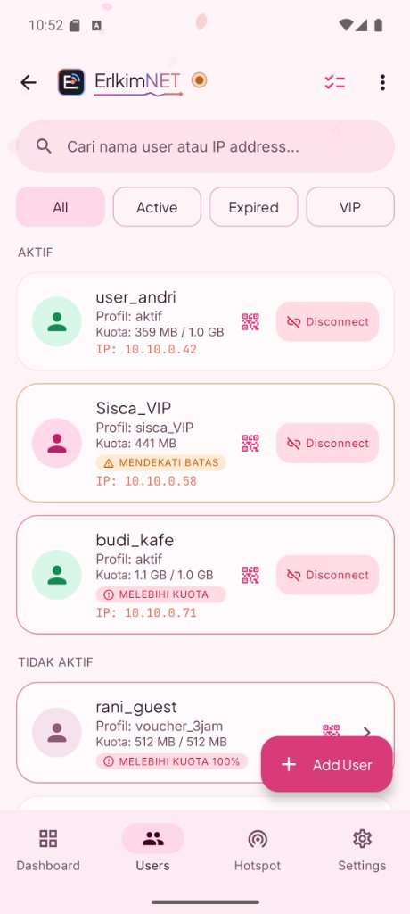
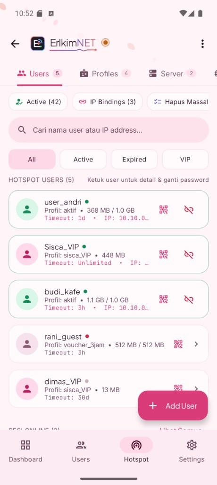
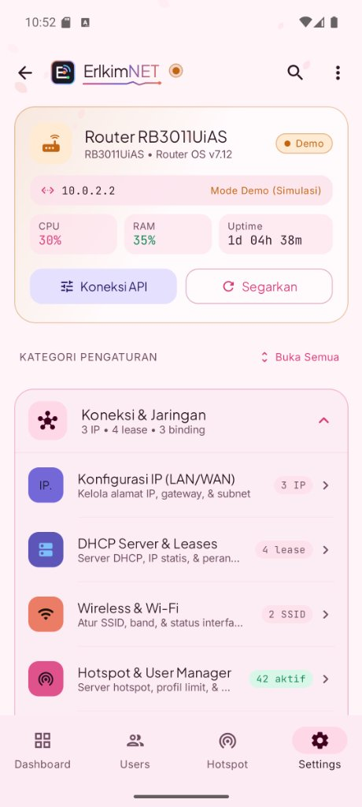

# Erlkim NET — Aplikasi Monitoring & Manajemen MikroTik RouterOS

**Erlkim NET** adalah aplikasi Android modern berbasis **Jetpack Compose (Material Design 3)** untuk memantau, mengelola, dan mengonfigurasi router **MikroTik RouterOS v7+** secara langsung melalui **REST API (`/rest/...`)** menggunakan autentikasi HTTP Basic Auth (HTTP maupun HTTPS).

---

## Daftar Isi

1. [Tampilan Demo Aplikasi](#tampilan-demo-aplikasi)
2. [Fitur Utama Aplikasi](#fitur-utama-aplikasi)
3. [Tech Stack & Arsitektur](#tech-stack--arsitektur)
4. [Syarat MikroTik RouterOS agar Bisa Terhubung](#syarat-mikrotik-routeros-agar-bisa-terhubung)
5. [Cara Konfigurasi Cepat di MikroTik](#cara-konfigurasi-cepat-di-mikrotik)
6. [Daftar Endpoint REST API yang Digunakan](#daftar-endpoint-rest-api-yang-digunakan)
7. [Mode Demo (Simulasi Lokal)](#mode-demo-simulasi-lokal)
8. [Kebutuhan Lingkungan Build](#kebutuhan-lingkungan-build)

---

## Tampilan Demo Aplikasi

| Dashboard Monitoring | Manajemen Users | Hotspot & Profiles | Pengaturan Router |
| :---: | :---: | :---: | :---: |
|  |  |  |  |
| Monitor CPU, RAM, Storage, Alert, & Grafik RX/TX | Daftar user aktif/nonaktif, QR Login, & batas kuota | Tab Users, Profiles, Server, Walled Garden, & IP Bindings | Status perangkat, Koneksi API, IP, DHCP, & Wi-Fi |

---

## Fitur Utama Aplikasi

### 1. Dashboard & Pemantauan Real-Time
- **Status Koneksi & Identitas Router**: Menampilkan nama identitas router, tipe board, versi RouterOS, uptime, serta indikator status (*Online*, *Menghubungkan*, *Mode Demo*, atau *Offline*).
- **Monitor Resource Hardware**: Memantau beban **CPU (%)**, penggunaan **RAM**, dan kapasitas **Storage/Flash** secara real-time dengan polling otomatis tiap 2,5 detik.
- **Grafik Trafik Real-Time**: Grafik kecepatan **Unduh (Download / RX)** dan **Unggah (Upload / TX)** dalam satuan Mbps dengan pilihan interface aktif (WAN/LAN/Hotspot).
- **Ringkasan Router & Pintasan Cepat**: Kartu ringkasan uptime, CPU load, jumlah user aktif, serta menu cepat ke Hotspot, Interfaces, DHCP Server, Wireless, IP Addresses, dan System & Reboot.
- **Ping Diagnostic**: Uji latensi jaringan (ms), TTL, jitter, dan *packet loss* ke gateway atau IP/host kustom, mendukung dua mode:
  - **Dari Perangkat (Device)**: Menggunakan ICMP (`/system/bin/ping`) dengan fallback TCP handshake.
  - **Dari RouterOS (REST API)**: Menjalankan ping langsung dari router via `POST /rest/ping`.

### 2. Manajemen Hotspot
- **Hotspot Users (Pengguna & Voucher)**:
  - Tambah user baru dengan pilihan profil langsung dari router, batas kuota data (MB), batas waktu (`limit-uptime`), komentar, dan generator password acak.
  - Pencarian cepat berdasarkan username, IP, MAC, profil, atau komentar, serta filter (**All**, **Active**, **Expired**, **VIP**).
  - Detail user: ubah password, atur *Session Timeout* (`limit-uptime`), aktifkan/nonaktifkan user, putuskan koneksi, dan hapus satuan maupun **hapus massal (Bulk Delete)**.
  - **Login QR Code**: Membuat QR Code otomatis untuk login Hotspot (*Auto-Login URL* maupun teks kredensial), lengkap dengan tombol salin dan bagikan.
- **Active Hotspot Sessions**: Memantau perangkat yang sedang login (username, IP, MAC address, uptime, konsumsi RX/TX) dan memutus sesi (*kick*) langsung dari aplikasi.
- **User Profiles**: Tambah, edit, dan hapus profil Hotspot (pengaturan `rate-limit`, `shared-users`, dan `session-timeout`).
- **Hotspot Servers**: Lihat daftar server Hotspot, tambah server baru, aktifkan/nonaktifkan, dan hapus.
- **IP Bindings**: Tambah, edit, aktifkan/nonaktifkan, dan hapus aturan `bypassed`, `blocked`, atau `regular` berdasarkan MAC/IP.
- **Walled Garden**: Kelola daftar host/domain dan port yang diizinkan bypass sebelum login Hotspot (CRUD + enable/disable).

### 3. Manajemen Jaringan (Network)
- **Interfaces**: Lihat daftar seluruh port/interface (status running/disabled, MAC address, MTU, total RX/TX bytes), toggle enable/disable, edit komentar & MTU, reset counter trafik, dan langsung pantau trafiknya di grafik Dashboard.
- **IP Addresses (LAN/WAN)**: Tambah, edit, aktifkan/nonaktifkan, dan hapus alamat IP lengkap dengan perhitungan CIDR/network.
- **DHCP Server & Leases**:
  - Kelola DHCP Server (tambah, edit, enable/disable, hapus).
  - Pantau daftar DHCP Leases, tambah *static lease*, ubah lease dinamis menjadi statis (`make-static`), enable/disable, dan hapus lease.
- **Wireless & Wi-Fi**: Mendukung baik paket wireless lama (`/rest/interface/wireless`) maupun paket Wi-Fi RouterOS v7 (`/rest/interface/wifi`), termasuk ubah SSID, frekuensi/channel, komentar/lokasi AP, dan toggle aktif/nonaktif.

### 4. Sistem, Keamanan & Backup
- **Identitas & Waktu Router**: Ubah *System Identity* router serta lihat informasi jam, tanggal, zona waktu, dan uptime router.
- **System Logs**: Pantau log RouterOS dengan filter tingkat keparahan (**All**, **Info**, **Warning**, **Error**), pencarian pesan/topik, serta aksi **Hapus Semua Log (Clear All Logs)** yang tersinkronisasi langsung dengan memori router (`POST /system/logging/action/clear` dengan fallback penyesuaian `memory-lines`).
- **Pengguna & Keamanan**: Lihat daftar akun admin RouterOS (`/rest/user`) beserta grup dan waktu login terakhir, serta akses cepat pengaturan kredensial API.
- **Backup & Restore**:
  - **Backup Internal Router**: Simpan file `.backup` langsung ke flash router (`system/backup/save`) dan muat ulang (`system/backup/load`).
  - **Ekspor & Impor File Konfigurasi**: Ekspor konfigurasi (identitas, IP addresses, profil hotspot, user hotspot, IP bindings, walled garden) ke format **JSON (`.json`)** atau **RouterOS Script (`.rsc`)**, serta pratinjau dan restore selektif kembali ke router.
- **Kontrol Daya (System & Power Control)**: Tombol *Quick Backup* sebelum restart, serta perintah **Reboot** dan **Shutdown** router dengan dialog konfirmasi keamanan.

### 5. Peringatan Otomatis & Personalisasi
- **Notifikasi Kuota Bandwidth**: Peringatan otomatis saat pemakaian data user Hotspot mendekati atau melebihi batas kuota, dengan aksi cepat untuk memutus user.
- **Peringatan Lonjakan Trafik (Throughput Alerts)**: Notifikasi saat total trafik (Unduh + Unggah) melebihi ambang batas Mbps yang ditentukan.
- **Peringatan CPU & Memori (Resource Alerts)**: Notifikasi saat beban CPU atau penggunaan RAM router melewati batas persentase.
- **Tema & Tampilan**: Mendukung mode **Gelap (Dark)**, **Terang (Light)**, **Ikuti Sistem**, **Material You (Dynamic Color)**, dan tema khusus **Anime Sakura**, serta tata letak adaptif untuk ponsel maupun tablet (*Bottom Navigation Bar* & *Navigation Rail*).

---

## Tech Stack & Arsitektur

### Bahasa & Framework Utama
| Komponen | Teknologi / Versi |
|---|---|
| **Bahasa Pemrograman** | Kotlin (`2.4.21`) |
| **UI Framework** | Jetpack Compose + Material Design 3 (`Compose BOM 2024.09.00`) |
| **Arsitektur** | MVVM (`AndroidViewModel`, `StateFlow`, `SharedFlow`, `collectAsStateWithLifecycle`) |
| **Navigasi** | Jetpack Navigation Compose (`2.8.9`) |
| **Asinkron & Konkurensi** | Kotlin Coroutines & Flow (`1.10.2`) |
| **Lifecycle & State** | AndroidX Lifecycle (`2.8.7`) dengan runtime Compose & ViewModel |
| **Android Build** | AGP `9.1.1`, `compileSdk 36.1` (Android 16), `targetSdk 36`, `minSdk 24` (Android 7.0+), Java 11 |
| **Optimasi APK Rilis** | R8 / ProGuard Minify + Resource Shrinking, Locale Filtering (`id`, `en`), Ukuran Rilis **~2.47 MB** (Budget < 3.0 MB) |

### Pustaka (Libraries) Utama
- **Networking**: **OkHttp (`4.10.0`)** murni untuk klien MikroTik REST API (`/rest/...`) dengan HTTP Basic Auth, pooling koneksi HTTP keep-alive, parallel async fetching snapshot router, dan bypass validasi sertifikat SSL/TLS untuk router lokal (LAN self-signed). *(Catatan: Aplikasi tidak menggunakan library pihak ketiga yang membengkakkan ukuran seperti Retrofit atau Moshi).*
- **JSON Serialization**: Native Android **`org.json` (`JSONObject`, `JSONArray`)** — sangat ringan, cepat, dan zero third-party overhead sehingga ukuran binary APK rilis tetap di bawah 2.5 MB.
- **Penyimpanan Lokal**: **Jetpack DataStore Preferences (`1.1.7`)** untuk menyimpan konfigurasi koneksi router, preferensi tema, serta ambang batas notifikasi kuota, trafik, dan resource secara non-blocking (DataStore async Flow).
- **QR Code Generator**: **ZXing Core (`3.5.3`)** untuk menghasilkan matriks QR Code login Hotspot secara offline dan lokal.
- **Tipografi**: Font lokal berlisensi open-source **Plus Jakarta Sans**, **Inter**, dan **JetBrains Mono** (untuk angka metrik, IP, MAC, dan log).
- **Ikon & Grafis**: Material Icons Core & Extended, serta custom Android Canvas untuk visualisasi grafik trafik real-time RX/TX dan rendering QR Code.
- **Pengujian (Testing)**: JUnit 4 (`4.13.2`), Robolectric (`4.16.1`), Kotlinx Coroutines Test (`1.10.2`), AndroidX Test Ext JUnit (`1.3.0`), dan Compose UI Test.

### Struktur Proyek Ringkas
```text
app/src/main/java/com/erlkim/mikrotik/
├── MainActivity.kt                  # Entry point, NavHost, Drawer, & manajemen Modal
├── data/
│   ├── backup/RouterBackupManager.kt # Serialisasi & parser backup .json / .rsc
│   ├── model/MikroTikModels.kt       # Data class domain RouterOS & konfigurasi alert
│   ├── network/
│   │   ├── MikroTikRestClient.kt     # Klien REST API RouterOS v7+ (/rest/...)
│   │   ├── PingDiagnosticEngine.kt   # Engine ping (Device ICMP/TCP & RouterOS API)
│   │   └── DemoRouterEngine.kt       # Simulator router lokal untuk Mode Demo
│   └── preferences/SettingsDataStore.kt # Penyimpanan preferensi DataStore
├── notifications/
│   └── QuotaNotificationHelper.kt    # Notifikasi sistem Android (kuota, trafik, CPU/RAM)
└── ui/
    ├── components/                   # Komponen UI (Chart, Ping, QR, Dialog, Sheets)
    ├── screens/                      # Layar utama (Dashboard, Hotspot, Users, Settings, Logs)
    ├── theme/                        # Palet warna, tipografi, tema Dark/Light/Sakura
    └── viewmodel/                    # ErlkimViewModel, ActiveModal, & state fitur
```

---

## Syarat MikroTik RouterOS agar Bisa Terhubung

Agar router MikroTik dapat terhubung dan dikelola sepenuhnya oleh **Erlkim NET**, pastikan seluruh syarat berikut terpenuhi:

1. **Versi RouterOS Wajib v7.1 atau Lebih Baru**
   - Aplikasi ini berkomunikasi menggunakan **MikroTik REST API** (`/rest/...`) yang baru diperkenalkan pada **RouterOS v7.1+**.
   - **RouterOS v6 tidak didukung** karena belum memiliki fitur REST API bawaan.

2. **Service `www` (HTTP) atau `www-ssl` (HTTPS) Harus Aktif**
   - REST API MikroTik berjalan di atas layanan web RouterOS:
     - **HTTP**: Service `www` aktif (port default `80`, atau port kustom sesuai konfigurasi router).
     - **HTTPS (Disarankan)**: Service `www-ssl` aktif (port default `443`) dengan sertifikat TLS terpasang di router. Aplikasi mendukung opsi **Trust Self-Signed Certificate** untuk penggunaan di jaringan lokal (LAN).

3. **Akun User RouterOS dengan Hak Akses (Policy) yang Memadai**
   - Akun yang dimasukkan di menu **Router Settings** harus memiliki grup dengan izin:
     - **Minimal untuk pemantauan (Read-Only)**: `rest-api`, `read`.
     - **Disarankan untuk manajemen penuh (CRUD, Kick, Backup, Reboot)**: grup `full` atau grup kustom dengan policy `rest-api, read, write, policy, test, reboot, sensitive`.
   - *Catatan*: Hindari menggunakan password kosong pada jaringan produksi demi keamanan.

4. **Konektivitas Jaringan & Firewall**
   - Perangkat Android harus berada dalam **jaringan yang sama (LAN/Wi-Fi)** dengan router MikroTik, atau dapat menjangkau IP router melalui **VPN / IP Publik**.
   - Pastikan **IP → Firewall → Filter Rules** (chain `input`) mengizinkan trafik TCP menuju port `www` (80) atau `www-ssl` (443) dari subnet perangkat Android Anda.
   - Jika service `www` / `www-ssl` dibatasi melalui parameter **Available From (`address`)**, pastikan IP atau subnet perangkat Android sudah termasuk di dalamnya.

5. **Paket Fitur Tambahan (Opsional Sesuai Kebutuhan)**
   - **Hotspot**: Memerlukan konfigurasi Hotspot aktif di router agar data server, user, active session, dan profile tampil.
   - **Wireless / Wi-Fi**: Router harus memiliki hardware Wi-Fi dengan paket `wireless` (legacy) atau `wifi-qcom` / `wifi-qcom-ac` (RouterOS v7).

---

## Cara Konfigurasi Cepat di MikroTik

Anda dapat menyiapkan akses REST API melalui **WinBox** atau **Terminal RouterOS** dengan perintah berikut:

### 1. Aktifkan Service HTTP (`www`) untuk Jaringan LAN
```routeros
/ip service enable www
/ip service set www port=80 address=192.168.88.0/24
```
*(Ganti `192.168.88.0/24` sesuai subnet jaringan lokal Anda, atau kosongkan `address` jika ingin bisa diakses dari semua subnet yang diizinkan firewall).*

### 2. (Opsional & Disarankan) Aktifkan HTTPS (`www-ssl`) dengan Self-Signed Certificate
```routeros
/certificate add name=erlkim-ca common-name=erlkim-ca key-usage=key-cert-sign,crl-sign
/certificate sign erlkim-ca
/certificate add name=erlkim-ssl common-name=192.168.88.1 key-usage=digital-signature,key-encipherment,tls-server
/certificate sign erlkim-ssl ca=erlkim-ca
/ip service set www-ssl certificate=erlkim-ssl disabled=no port=443
```
Lalu aktifkan opsi **HTTPS** dan **Trust Self-Signed** di menu **Router Settings** pada aplikasi Erlkim NET.

### 3. Buat Akun Khusus untuk Aplikasi (Opsional)
```routeros
/user group add name=erlkim-api policy=rest-api,read,write,test,reboot,policy,sensitive
/user add name=erlkimadmin password="PasswordKuat123!" group=erlkim-api
```

### 4. Uji Koneksi di Aplikasi
1. Buka aplikasi **Erlkim NET** → ketuk ikon profil router / menu **Router Settings**.
2. Masukkan **IP Address/Host** (contoh `192.168.88.1`), **Port** (`80` untuk HTTP atau `443` untuk HTTPS), **Username**, dan **Password**.
3. Pastikan **Mode Demo** dalam keadaan nonaktif.
4. Tekan **Test Connection** untuk memverifikasi respon router, lalu tekan **Simpan & Hubungkan**.

---

## Daftar Endpoint REST API yang Digunakan

Semua request dikirim ke `http(s)://<host>:<port>/rest/<endpoint>` dengan header `Authorization: Basic ...`:

| Kategori | Endpoint REST API | Operasi |
|---|---|---|
| **Sistem & Kesehatan** | `system/resource`, `system/identity`, `system/clock`, `log`, `user`, `system/logging/action`, `system/logging/action/clear` | `GET`, `PATCH`, `POST` (`system/identity/set`, `system/reboot`, `system/shutdown`, `system/logging/action/clear`) |
| **Backup Router** | `system/backup/save`, `system/backup/load` | `POST` |
| **Interfaces & Trafik** | `interface`, `interface/monitor-traffic`, `interface/reset-counters` | `GET`, `PATCH`, `POST` |
| **IP & DHCP** | `ip/address`, `ip/dhcp-server`, `ip/dhcp-server/lease`, `ip/dhcp-server/lease/make-static` | `GET`, `PUT`, `PATCH`, `DELETE`, `POST` (`make-static` dengan body `{"numbers": "<id>"}`) |
| **Wireless / Wi-Fi** | `interface/wireless` atau `interface/wifi`, `interface/wireless/registration-table`, `interface/wifi/registration-table` | `GET`, `PATCH` |
| **Hotspot** | `ip/hotspot`, `ip/hotspot/user`, `ip/hotspot/active`, `ip/hotspot/user/profile`, `ip/hotspot/ip-binding`, `ip/hotspot/walled-garden` | `GET`, `PUT`, `PATCH`, `DELETE` |
| **Diagnostik** | `ping` | `POST` |

---

## Mode Demo (Simulasi Lokal)

Jika Anda belum terhubung ke perangkat MikroTik fisik, Anda dapat mengaktifkan **Mode Demo** melalui kartu koneksi di Dashboard atau menu **Router Settings**. Mode Demo menjalankan simulator lokal (`DemoRouterEngine`) yang meniru perangkat `RB3011UiAS (RouterOS v7.12)` agar seluruh tampilan, grafik trafik, CRUD Hotspot, DHCP, IP Address, dan Backup/Restore dapat dicoba secara offline.

---

## Kebutuhan Lingkungan Build

- **JDK**: Java 11 atau lebih baru
- **Android SDK**: Compile SDK 36.1 (`compileSdk { version = release(36) { minorApiLevel = 1 } }`), `minSdk 24` (Android 7.0+), `targetSdk 36`
- **Gradle**: Kotlin DSL (`build.gradle.kts`) dengan Version Catalog (`gradle/libs.versions.toml`) dan AGP `9.1.1`
- **Target Ukuran Binary**: APK Release rilis ter-obfuscate R8 berada di kisaran **~2.47 MB** (budget maks. 3.0 MB)
